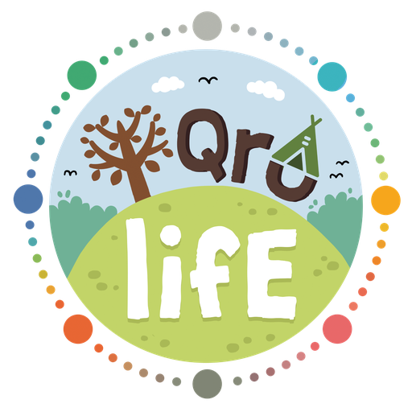

<p align="center">
  
</p>

<h1 align="center">Ruang Tumbuh Iqrolife</h1>

<p align="center">
  <em>Cerita, wawasan, dan praktik baik untuk keluarga yang terus belajar dan bertumbuh sesuai fitrah.</em>
</p>

<p align="center">
  
  
  
  
  
  
</p>

---

## ✨ Tentang Proyek

**Ruang Tumbuh** adalah blog komunitas [Iqrolife](https://www.iqrolife.id/) — ruang belajar terbuka bagi keluarga Indonesia yang ingin menjalani pendidikan secara fitrah, bertahap, dan paripurna. Platform ini menampilkan artikel, cerita kontributor, topik tematik, dan informasi program Iqrolife.

### Fitur Utama

| Fitur | Deskripsi |
|---|---|
| 📝 **Artikel & Cerita** | Konten rich-text dengan Portable Text, gambar optimasi CDN Sanity |
| 🏷️ **Topik Tematik** | Kategorisasi artikel berdasarkan topik keluarga & pendidikan |
| 👥 **Profil Kontributor** | Halaman kontributor dengan bio, foto, dan daftar tulisan |
| ✉️ **Kirim Cerita** | Form pengiriman cerita dari komunitas langsung ke Sanity |
| 🎓 **Program** | Banner promosi program & kegiatan Iqrolife |
| 🔍 **Pencarian** | Pencarian artikel secara cepat |
| 📰 **Newsletter** | Section newsletter (siap dihubungkan ke provider pilihan) |
| 🎨 **Sanity Studio** | CMS terintegrasi di `/studio` untuk manajemen konten |
| 🌐 **SEO** | Sitemap, robots.txt, Open Graph metadata, dan structured data |
| 🌱 **Demo Data** | Seed script untuk mengisi konten demo secara instan |

---

## 🏗️ Arsitektur

```
blog-iqrolife/
├── public/images/           # Aset statis (logo, ikon, OG image)
├── scripts/
│   └── seed.mjs             # Script pengisi data demo ke Sanity
├── src/
│   ├── app/                 # Next.js App Router
│   │   ├── api/             # API routes (webhook revalidation)
│   │   ├── artikel/         # Halaman daftar & detail artikel
│   │   ├── kirim-cerita/    # Form kirim cerita
│   │   ├── kontributor/     # Halaman profil kontributor
│   │   ├── studio/          # Sanity Studio (embedded)
│   │   ├── topik/           # Halaman topik/kategori
│   │   ├── layout.tsx       # Root layout (Header + Footer)
│   │   ├── page.tsx         # Homepage
│   │   ├── sitemap.ts       # Dynamic sitemap generator
│   │   └── robots.ts        # robots.txt generator
│   ├── components/          # Komponen UI reusable
│   │   ├── Header.tsx       # Navigasi utama
│   │   ├── Footer.tsx       # Footer situs
│   │   ├── PostCard.tsx     # Kartu preview artikel
│   │   ├── SearchForm.tsx   # Form pencarian
│   │   ├── StoryForm.tsx    # Form kirim cerita
│   │   ├── PortableArticle.tsx  # Renderer Portable Text
│   │   └── Icon.tsx         # Komponen ikon SVG
│   ├── data/
│   │   └── demo.ts          # Data demo fallback
│   ├── sanity/
│   │   ├── lib/             # Client, queries, image helpers
│   │   ├── schemaTypes/     # Schema: post, author, category, dll.
│   │   └── structure.ts     # Kustomisasi struktur Studio
│   └── types/               # TypeScript type definitions
├── sanity.config.ts         # Konfigurasi Sanity Studio
├── next.config.ts           # Konfigurasi Next.js
├── tsconfig.json            # Konfigurasi TypeScript
└── package.json
```

### Tech Stack

| Layer | Teknologi |
|---|---|
| **Framework** | [Next.js 16](https://nextjs.org/) — App Router, Server Components, ISR |
| **UI** | [React 19](https://react.dev/) — Vanilla CSS, Styled Components |
| **CMS** | [Sanity 5](https://www.sanity.io/) — Embedded Studio, Portable Text, CDN Images |
| **Bahasa** | [TypeScript 5](https://www.typescriptlang.org/) — end-to-end type safety |
| **Validasi** | [Zod 4](https://zod.dev/) — runtime schema validation |
| **Linting** | [ESLint 9](https://eslint.org/) dengan `eslint-config-next` |

---

## 🚀 Memulai

### Prasyarat

- **Node.js** ≥ 22.12.0
- **npm** (bawaan Node.js)
- Akun [Sanity.io](https://www.sanity.io/) (gratis)

### 1 — Clone & Install

```bash
git clone https://github.com/iqrolife/blog-iqrolife.git
cd blog-iqrolife
npm install
```

### 2 — Konfigurasi Environment

```bash
cp .env.example .env
```

Isi variabel berikut di file `.env`:

| Variabel | Deskripsi | Wajib |
|---|---|---|
| `NEXT_PUBLIC_SITE_URL` | URL produksi situs | ❌ |
| `NEXT_PUBLIC_SANITY_PROJECT_ID` | Project ID dari Sanity Manage | ✅ |
| `NEXT_PUBLIC_SANITY_DATASET` | Nama dataset (default: `production`) | ❌ |
| `NEXT_PUBLIC_SANITY_API_VERSION` | Versi API Sanity | ❌ |
| `SANITY_API_WRITE_TOKEN` | Token Editor untuk form & seed script | ⚠️ |
| `SANITY_REVALIDATE_SECRET` | Secret untuk webhook revalidation | ❌ |

> **💡 Tip:** Buat project Sanity di [sanity.io/manage](https://www.sanity.io/manage), lalu salin Project ID dari dashboard.

### 3 — Isi Data Demo (Opsional)

```bash
npm run seed
```

Script ini mengisi Sanity dengan artikel, kategori, kontributor, dan program contoh agar situs langsung memiliki konten.

### 4 — Jalankan Development Server

```bash
npm run dev
```

Buka [http://localhost:3000](http://localhost:3000) untuk situs blog, dan [http://localhost:3000/studio](http://localhost:3000/studio) untuk Sanity Studio.

---

## 📜 Perintah yang Tersedia

| Perintah | Fungsi |
|---|---|
| `npm run dev` | Jalankan development server |
| `npm run build` | Build produksi |
| `npm run start` | Jalankan server produksi |
| `npm run lint` | Jalankan ESLint |
| `npm run typecheck` | Cek type TypeScript |
| `npm run seed` | Isi data demo ke Sanity |
| `npm run sanity:deploy` | Deploy Sanity Studio ke hosting Sanity |
| `npm run sanity:manage` | Buka Sanity project management |

---

## 📂 Sanity Schema

| Schema | Deskripsi |
|---|---|
| `post` | Artikel blog dengan judul, slug, konten rich-text, gambar, kategori, dan penulis |
| `author` | Kontributor dengan nama, foto, bio, dan slug |
| `category` | Topik/kategori artikel dengan ikon dan deskripsi |
| `program` | Program & kegiatan Iqrolife |
| `storySubmission` | Kiriman cerita dari komunitas |
| `siteSettings` | Pengaturan umum situs |
| `blockContent` | Konfigurasi blok Portable Text |

---

## 🌍 Deployment

Proyek ini siap di-deploy ke platform hosting modern:

### Vercel (Rekomendasi)

1. Push repository ke GitHub
2. Import project di [vercel.com](https://vercel.com/)
3. Tambahkan environment variables dari `.env`
4. Deploy ✅

### Webhook Revalidation

Untuk ISR (Incremental Static Regeneration), atur webhook di Sanity:

1. Buka **Sanity Manage → API → Webhooks**
2. URL: `https://your-domain.com/api/revalidate`
3. Set secret yang sama dengan `SANITY_REVALIDATE_SECRET`

---

## 🤝 Kontribusi

Kami menyambut kontribusi dari komunitas! Berikut cara berkontribusi:

1. **Fork** repository ini
2. Buat **branch** fitur: `git checkout -b fitur/fitur-baru`
3. **Commit** perubahan: `git commit -m "feat: tambah fitur baru"`
4. **Push** ke branch: `git push origin fitur/fitur-baru`
5. Buat **Pull Request**

> Pastikan `npm run lint` dan `npm run typecheck` lolos sebelum membuat PR.

---

## 📄 Lisensi

Proyek ini dilisensikan di bawah [MIT License](LICENSE) — bebas digunakan, dimodifikasi, dan didistribusikan.

---

<p align="center">
  Dibangun dengan 💚 oleh tim <a href="https://www.iqrolife.id/">Iqrolife</a><br/>
  <em>Tumbuh tidak harus sendirian.</em>
</p>
